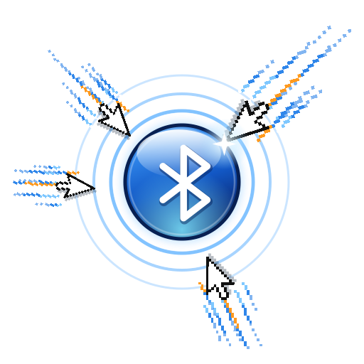

<!-- ==================================================================================
     SUITE LOGO: the PocketKnives logo (assets/icon.svg). It's pixel art: 96 px is its
     48 px version doubled; keep any new size a whole-number multiple
     (docs/logo-concepts/README.md). Replace only what's between this comment and END SUITE LOGO.
     ================================================================================== -->
<p align="center">
  
</p>
<!-- END SUITE LOGO -->

<h1 align="center">PocketKnives</h1>

<p align="center">
  Small, fast tools that fix everyday annoyances on Windows 11. Each tool is a <b>blade</b>.
</p>

## Blades

###  SnipSnap

Copies a rectangle, a window or the whole screen to the clipboard from a hotkey. It's a 16 KB
native exe that uses 1–2 MB in the background. [Read more](blades/snipsnap/README.md)

###  QuickTooth

Connects or disconnects your AirPods with one click on a taskbar icon, in a second or two instead
of about 16 seconds through Quick Settings. [Read more](blades/quicktooth/README.md)

###  NowPlaying

Shows the current media's album cover, source app icon, seekable timeline and live 5-band audio
frequency meter docked cleanly in the Windows 11 taskbar. [Read more](blades/nowplaying/README.md)

###  Pulse

Shows CPU, memory, GPU, disk, network and the time as seven-segment readouts and dot-matrix graphs
in a calculator-style bar along the top of the screen; hover a reading for its last minute.
[Read more](blades/pulse/README.md)

## Install

Windows 11 (or Windows 10 2004+), no admin rights. Build the installer and run it:

```powershell
.\installer\build.ps1    # builds dist\PocketKnives-Setup-<version>.exe
```

It needs Visual Studio's C++ build tools, Rust through [rustup](https://rustup.rs) (the repo pins
the version) and Inno Setup 6.7+ (`winget install JRSoftware.InnoSetup`); the first build downloads
the Windows App SDK runtime for the Windows 11 settings window from nuget.org. It installs every blade into
`%LOCALAPPDATA%\Programs\PocketKnives` and asks which should start when you sign in. The installer
is unsigned, so SmartScreen warns about it.

Open the taskbar's hidden icons arrow and click **PocketKnives** to open Settings. The same window
is under **PocketKnives Settings** in the Start menu. Its Blades list controls which tools start
when you sign in, and General lets you change the window's look.

## Working on PocketKnives

People and coding agents alike: start with [`AGENTS.md`](AGENTS.md), then the `AGENTS.md` in the
blade's folder. To add a tool, see [adding a blade](docs/working/adding-a-blade.md).

## History

Each blade was imported with its full history. SnipSnap came from the `quicksnip` repo (branch
`snipsnap`), QuickTooth from [benjkr/quicktooth](https://github.com/benjkr/quicktooth) (branch
`main`). QuickTooth's "Merge pull request #N" commits refer to pull requests in benjkr/quicktooth,
not in this repo.

<sub>Created in [T3 Code](https://t3.codes).</sub>
