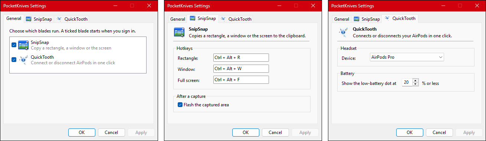
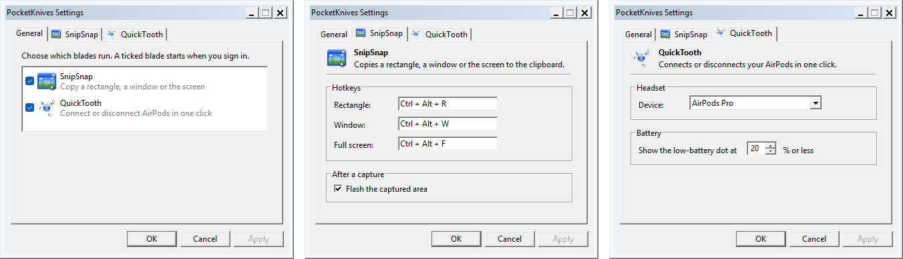

# Runner design: how blades run together

**Status: a proposal, not decided.** Nothing here is built. Decided by the user so far: there will
be a settings window (minimalistic, native Windows XP/7-style controls, every blade's icon in it).
Once the user picks the rest, this page shrinks to the decision (in [decisions](decisions.md)) and
specs for the runner and the window; the measurements stay in the commits' history.

The question: SnipSnap is one C file and QuickTooth is C# / .NET Native AOT. Should the suite
become one process and one language, and what makes adding a blade easy?

## What was measured

On this PC (Windows 11 26300, a 4480×1440 virtual screen, the same layout as SnipSnap's README),
with throwaway prototypes in a scratch folder (not in the repo):

- **C idle loop**: a message-only window and its message loop, built with SnipSnap's exact flags.
- **C# floor**: the same in C#, Native AOT, with QuickTooth's publish settings and runtime pin.
- **C# SnipSnap skeleton**: not a port. It has SnipSnap's shape and compiles in the same
  Win32/GDI/DWM calls (grab, dim, overlay paint, window list, clipboard, flash, hotkeys, console,
  quit), so its size is close to a real port's. It only idles while measured.
- **C# host + C DLL**: the floor plus a 2 KB no-CRT C DLL loaded through a C ABI.
- The user's running SnipSnap and QuickTooth, read-only.

Memory is read after 5 s idle (median of 3 runs) as private working set (the `Working Set -
Private` counter) and private bytes (commit). Start-to-exit is `CreateProcess` to process exit,
median of 40. The pixel loops ran on synthetic buffers; nothing read the screen. KB and MB are
1024-based.

| | Exe | Private working set | Private bytes | Start to exit |
|---|---|---|---|---|
| C idle loop | 3 KB | 0.62 MB | 0.96 MB | 8.9 ms |
| C# AOT floor | 840 KB | 1.22 MB | 2.83 MB | 15.0 ms |
| C# SnipSnap skeleton | 858 KB | 1.20 MB | 2.80 MB | 14.0 ms |
| C# host + C DLL loaded | 974 KB (with its benchmark code) + 2 KB | 1.21 MB | 2.82 MB | — |
| SnipSnap, running (user's) | 16 KB | 0.46 MB | 1.66 MB | — |
| QuickTooth, running (user's) | 5.1 MB | 17.0 MB | 21.1 MB | 17.1 ms (a scratch build, `--version`) |

- SnipSnap's per-pixel loops on a 4480×1440 frame (six runs each, C and C# alternating, each the
  median of 31): the dimming that runs before the overlay appears takes 3.9 ms in C (3.4–4.6) and
  5.3 ms in C# (5.1–7.0); the 24-bit clipboard conversion, after the click, takes 4.3–4.9 ms in
  both.
- A call through the C ABI costs 3.1 ns (a managed call: 0.6 ns).
- For comparison, PowerToys runs here as one process per module; its runner process uses 2.3 MB
  private working set.
- Not measured: the hotkey-to-overlay time itself (it means pressing hotkeys and capturing the
  user's screen). The ~70 ms is the README's figure. Most of it is GDI reading the screen back
  from the compositor and DWM showing the window: the same calls in either language.

## The options

### A. A runner that starts each blade as its own process (any language)

Each blade stays its own exe, in whatever language suits it, and describes itself in a small
manifest (`blades/<name>/blade.json`): its name, exe, whether it runs in the background, its
one-shot commands, how to stop it, and how it starts with Windows. A small `pk` runner reads the
manifests: it lists blades and starts, stops or checks them through their command lines. At
sign-in it starts the enabled blades and exits, so it costs nothing while they run. PowerToys mostly
works this way: its runner loads a small module DLL per tool, and most tools do their work in
their own process.

- Size, memory and latency: every blade keeps its numbers. SnipSnap stays 16 KB and about 0.5 MB.
  The settings window is part of the runner and runs only while it's open (below), so nothing of
  the runner stays resident.
- Settings go through each blade's command line, so the window works the same for a C blade and a
  C# one.
- Isolation: a crash or a stall in one blade (a slow Bluetooth call, say) never touches another.
- The mixed languages stay, but behind one contract: the same folder layout, manifest, command-line
  conventions and docs. That contract is what users and agents deal with.
- Command-line conventions for new blades: no argument runs it in the background; `--exit`,
  `--version` and `--help`; exit codes `0` done, `1` cancelled or nothing to do, `2` failed or bad
  usage. The manifest maps existing differences (SnipSnap stops with `quit`), so neither blade has
  to change first.

### B. One process, one language: SnipSnap ported to C# on a shared `PocketKnives.Core`

- **Size**: SnipSnap on its own goes from 16 KB to about 860–900 KB, about 55 times bigger (the
  skeleton: 858 KB). Inside one shared exe it adds only about 20 KB, but that exe is QuickTooth's
  5.1 MB.
- **Background memory**: on its own, 0.5–0.6 MB becomes about 1.2 MB private working set (1.0 →
  2.8 MB private bytes). Inside the shared process it adds almost nothing, so the suite saves
  SnipSnap's own process: about 0.5 MB private working set (1.7 MB private bytes).
- **Hotkey to overlay**: about 70 → 71–73 ms (estimated). The measured language difference on that
  path is the dimming loop, 1–3 ms slower (vectorising it would win that back); the screen
  readback and DWM are the same calls. A one-shot run from a launcher (`snipsnap rect`) starts
  6 ms later (8.9 → 15.0 ms). In a shared process the hotkey also waits whenever another blade is
  busy on the UI thread (not measured).
- **Settings**: the one thing a single process makes simpler. The window could change settings in
  memory instead of through a command line, though it would still save them to files.
- **Cost**: rewriting 840 lines of working C, and giving up its budget rules (no CRT, about 16 KB)
  in exchange for about 0.5 MB. One crash takes every blade down.

### C. One C# process hosting C blades as native DLLs through a C ABI

- Calls are cheap (3 ns) and the DLL is tiny (2 KB). Hosting it adds nothing to the host's idle
  memory, so the suite saves the same ~0.5 MB as option B.
- But both languages stay. The suite gains an ABI to version, and SnipSnap's frozen-screen
  overlay would run inside the host (its hotkeys and message loop on the host's thread, or a
  thread the ABI has to define). Its one-shot command line still needs an exe, and crash
  isolation is gone.
- Settings would have to cross the ABI as well.
- Everything B's merge would save, at a higher price than A.

## The settings window (decided: there is one)

One window changes each blade's behaviour, looks and settings. It's minimalistic and native: plain
Win32 common controls, no UI framework, in the `pk` runner. A throwaway prototype (C# Native AOT,
placeholder values, wired to nothing) looks like this, captured off-screen with `PrintWindow`:

- **The look: themed common controls** (comctl32 v6, the manifest QuickTooth already uses). These
  are the controls of the Windows 7 and 10 era: group boxes, check boxes, hotkey boxes, an
  up-down, a drop-down, tabs and OK / Cancel / Apply, in the system font (Segoe UI 9). Square
  corners (a DWM setting) and no caption icon, as on XP/7 property dialogs.
- **The other native look: classic controls**, the same window with themes switched off
  (`SetWindowTheme`), which also gives it the classic title bar. Grey and 3D, like Windows 2000 or
  XP's classic theme. The list's check boxes stay themed there.

  

- **What native controls can't give**: XP's Luna or 7's Aero glass. In the themed look the title
  bar stays Windows 11's, and native controls have no dark mode. Drawing the old chrome by hand
  would no longer be native, so it's out.
- **Icons**: each blade's icon on its tab (16 px), at the top of its page with its name and one
  line on what it does (32 px), and in the General tab's list (32 px, the native Tiles view, as in
  7's Explorer, with a check box per blade). Win32 can't draw SVG, so each blade also keeps
  `blades/<name>/assets/icon.ico` (16–48 px, rendered from its `icon.svg`; SnipSnap's is 9 KB),
  and the runner builds them into its exe. QuickTooth already has one
  (`blades/quicktooth/assets/quicktooth.ico`).
- **Measured** (the prototype with both icons): an 864 KB exe with zero AOT warnings; 1.6 MB
  private working set while open; 77 ms from launch to painted (median of 30). Closed, it costs
  nothing.

How it works with a process per blade:

- **Where it lives**: `pk settings [blade]` opens it; nothing stays running after it closes.
- **Opening it**: a Start menu entry ("PocketKnives Settings"), "Settings…" in QuickTooth's tray
  menu, and `snipsnap settings` (SnipSnap has no tray icon by design).
- **Who reads and writes a blade's settings: only the blade.** `blade.json` lists the settings
  (key, kind, label, choices, default), so the window builds each page by itself. It reads the
  values with `<blade> --settings` (`key=value` lines) and applies them with
  `<blade> --set key=value …`, which checks them and writes the blade's own file: SnipSnap an INI
  file through kernel32 (no new DLL), C# blades their JSON settings. That's one process start per
  blade when the window opens and per Apply (9–15 ms, measured).
- **A running blade picks up a change** when `--set` posts it `PocketKnives.Reload.v1`. It re-reads
  its file and applies it (SnipSnap re-registers its hotkeys). For SnipSnap, reading an INI file
  and this reload take 1 KB (16,384 → 17,408 bytes, zero warnings, still only its four DLLs;
  measured on a scratch copy).
- **Which things become settings is the owner's call.** The prototype shows:

  | Setting | Today |
  |---|---|
  | Each blade on or off (on: it starts at sign-in) | Exists per blade (SnipSnap's Startup shortcut, QuickTooth's Run value) |
  | SnipSnap's three hotkeys | Fixed in code (with fallbacks): new as a setting |
  | SnipSnap: flash the captured area | Always on: new as a setting |
  | QuickTooth's device | Exists (its tray menu's Device ▸) |
  | QuickTooth's low-battery level (20%) | Fixed in code: new as a setting |

  Looks the user chose from alternatives (QuickTooth's decisions) aren't offered as choices.

## The default language and shared code for new blades

- **Default: C# / .NET 10, Native AOT**, like QuickTooth. A new C# blade starts at about 0.85 MB of
  exe, 1.2 MB private working set and a 15 ms start (the measured floor). That's small enough to
  run as its own process, safe, quick to write, and QuickTooth already shows the whole path:
  source-generated JSON and COM, zero AOT warnings, a runtime patch pin, and a shared core that
  also runs in a browser simulator.
- **C stays allowed** when size, memory or latency is the feature, as for SnipSnap. A C blade
  follows the same manifest and command-line contract but doesn't get the shared library.
- **Shared code**, extracted from QuickTooth (it already has all of this except hotkeys) rather
  than written anew, in two projects every C# blade references and compiles into its own exe
  (trimmed, so a blade pays only for what it uses):
  - `PocketKnives.Core` (no Windows APIs, so a blade's core can run in a simulator too): settings
    through source-generated JSON, saved via a temp file and a move; the log
    (`yyyy-MM-dd HH:mm:ss.fff [pid] message`, rolled to `.old` at 512 KB); command-line parsing.
  - `PocketKnives.Windows`: the tray icon host (`Shell_NotifyIcon` v4, re-added when Explorer
    restarts, theme and DPI changes); global hotkeys with fallback lists, reporting which ones
    registered (SnipSnap's scheme); single instance (a mutex, plus a window class and a registered
    message so a second start forwards its command to the running copy); start with Windows (the
    `HKCU\…\Run` value); attaching to the parent console for CLI output.
  - The suite-wide `Directory.Build.props` and `.targets` (nullable, invariant globalisation, the
    runtime patch pin) move to the repo root.

## Recommendation

**Option A**: a runner that starts each blade as its own process, with a per-blade manifest and
command-line conventions. New blades default to C# Native AOT on the shared `PocketKnives.Core`
and `PocketKnives.Windows`; C only when the budget is the product.

- **Why**: the measured price of separate processes is about 0.6 MB per C blade and 1.2 MB per C#
  blade, while merging costs SnipSnap its 16 KB and no-CRT design, a rewrite and crash isolation,
  all to save about 0.5 MB. The language mix is real, but the user never sees it, and agents meet
  it only through the same contract and docs.
- **What it costs**:
  - A small `pk` runner with the settings window (C# AOT, about 0.86 MB, nothing resident) and a
    `blade.json` for each blade.
  - `--settings`, `--set` and the reload message in each blade (about 1 KB in SnipSnap), plus an
    `icon.ico` for SnipSnap.
  - Extracting the shared projects from QuickTooth, checked with its "identical behaviour" rule:
    every simulator scenario's log, timeline and final state diffed before and after.
  - Later, with the user's go on their PC: one sign-in entry for the runner instead of SnipSnap's
    Startup shortcut and QuickTooth's Run value, and a suite installer.
  - Two languages to keep building (MSVC and the .NET SDK), as today.
- **Adding a blade then**:
  1. Copy the template folder (or `pk new <name>`) to `blades/<name>/`. It has a C# project that
     references the shared projects, plus `blade.json`, `AGENTS.md`, a README, docs and an icon
     (`icon.svg` and `icon.ico`).
  2. Write the blade. Tray, hotkeys, settings (`--settings`, `--set`, the reload), log, single
     instance, autostart and the command line come from the shared code.
  3. Fill in `blade.json`, its settings included. The runner and the settings window find it
     there: the blade gets its tab, icon and controls with no change to either.
  4. Follow the rest of the [adding a blade](adding-a-blade.md) checklist: the rows in the root
     `AGENTS.md`, `README.md` and live testing.
